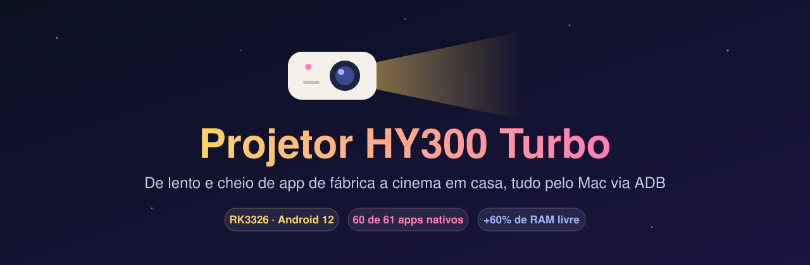
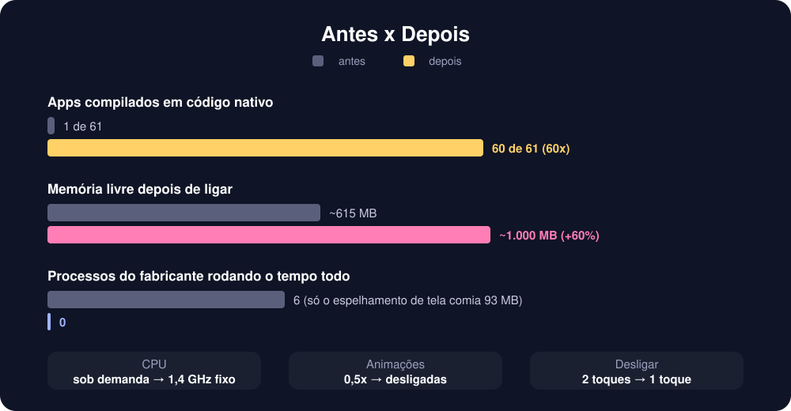
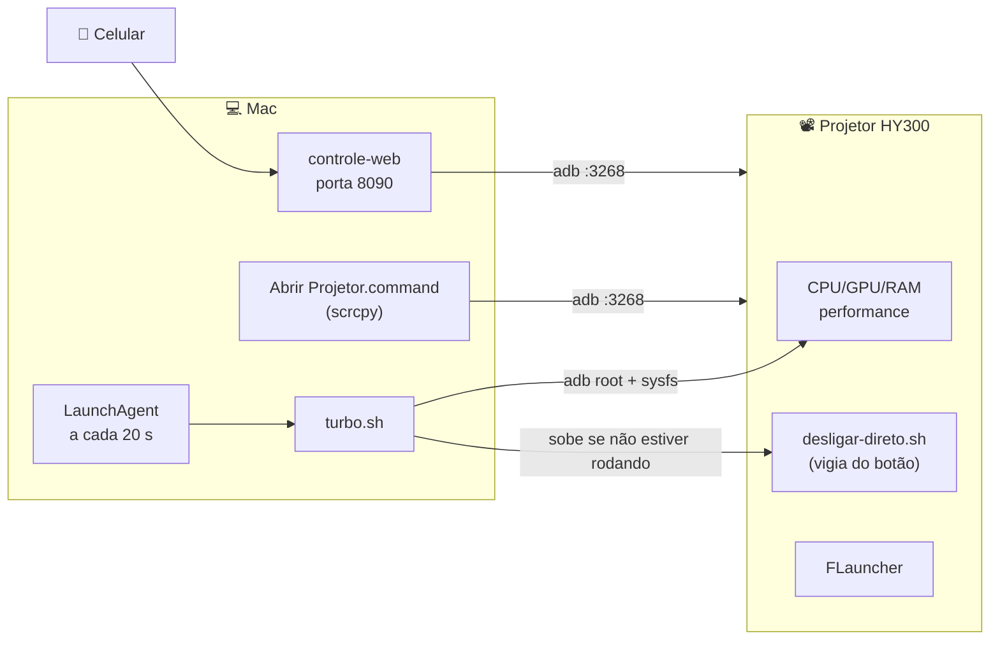

<p align="center">
  
</p>

<p align="center">
  
  
  
  
</p>

<p align="center">
  <b>Projetor "HY300" de marketplace, lento e cheio de app de fábrica, virando um cinema em casa rápido e fácil para criança usar.</b><br>
  Tudo feito pelo Mac, via ADB na rede. Sem trocar firmware, sem root no aparelho e com botão de desfazer.
</p>

<p align="center">
  <a href="#-performance">Performance</a> ·
  <a href="#-o-que-muda">O que muda</a> ·
  <a href="#-passo-a-passo">Passo a passo</a> ·
  <a href="#-armadilhas">Armadilhas</a> ·
  <a href="#-limites-do-hardware">Limites</a> ·
  <a href="#-desfazer">Desfazer</a>
</p>

---

## 🚀 Performance

<p align="center">
  
</p>

| Métrica | Antes | Depois | Ganho |
|---|:---:|:---:|:---:|
| 🧩 Apps compilados em código nativo (`speed`) | 1 de 61 | **60 de 61** | **60x** mais apps nativos |
| 🧠 Memória livre depois de ligar | ~615 MB | **~1.000 MB** | **+60%** |
| 🗑️ Processos do fabricante rodando o tempo todo | 6 | **0** | o maior sozinho ocupava 93 MB |
| ⚡ CPU (4 núcleos) | sobe sob demanda (`interactive`) | **1,4 GHz fixo** (`performance`) | sem o atraso de "acordar" |
| 🎮 GPU e memória (`devfreq`) | sob demanda | **sempre no máximo** | menuzinho e rolagem sem engasgo |
| 🎞️ Animações do sistema | 0,5x | **desligadas** | resposta imediata no controle |
| 🔌 Desligar | 2 toques (botão + OK) | **1 toque** | |

**O que isso significa na prática:** a tela inicial abre na hora, os apps abrem mais rápido porque já estão
compilados, e o controle responde sem aquele atraso de meio segundo. A temperatura com tudo no máximo ficou
em **50 °C**, bem abaixo do limite do chip.

<details>
<summary><b>Como foi medido</b></summary>

- **Apps compilados:** `dumpsys package dexopt`, contando `status=speed` antes e depois de `pm compile -m speed -a`.
- **Memória:** antes, `Free RAM` do `dumpsys meminfo` com o sistema de fábrica; depois, `MemAvailable` de `/proc/meminfo` após reiniciar. São números do mesmo aparelho, mas de comandos diferentes, então leia o +60% como aproximado.
- **Processos:** `dumpsys meminfo` (PSS por processo). O espelhamento de tela `com.bozee.usbdisplay` era o maior, com 93 MB.
- **CPU/GPU:** `scaling_governor` e `scaling_cur_freq` em `/sys/devices/system/cpu`, e `governor` em `/sys/class/devfreq`.
- **Temperatura:** `/sys/class/thermal/thermal_zone*/temp` com o YouTube tocando.

</details>

> [!NOTE]
> O gargalo que sobra é o próprio chip: o RK3326 **não tem decodificador VP9/AV1**, então o YouTube ainda engasga acima de 480p. A otimização tira tudo que atrapalha, mas não cria hardware.

---

## ✨ O que muda

<table>
<tr>
<td width="50%" valign="top">

### 😩 Antes
- Tela inicial do fabricante, lenta
- App chinês, espelhamento e atualizador rodando escondidos
- Apps reinstalando sozinhos
- Processador "dormindo" até apertar um botão
- Só dá para usar com o controle IR
- Desligar pede confirmação

</td>
<td width="50%" valign="top">

### 😍 Depois
- **FLauncher** limpo, só os apps de vídeo, fundo personalizado
- Nada do fabricante rodando sem precisar
- Nada volta depois de reiniciar
- CPU, GPU e memória no máximo a cada boot
- Controle pelo **Mac** (mouse e teclado) e pelo **celular**
- **Um toque** no botão de energia desliga

</td>
</tr>
</table>

### Como as peças conversam



---

## 🛠️ Passo a passo

> [!IMPORTANT]
> "HY300" é um nome genérico. Este é **Rockchip RK3326, Android 12, 2 GB, 720p**. Confira o seu com
> `adb shell getprop ro.board.platform` antes de aplicar. Em outro chip os caminhos e os pacotes mudam.

<details open>
<summary><b>1. Ligar o ADB pela rede</b></summary>

1. No projetor, instale o **Activity Launcher** pela Play Store.
2. Abra *Configurações de projeção* > **DevelopmentActivity** (as Opções do programador ficam escondidas no menu normal).
3. Ligue **Depuração USB** e **Internet Adb**.
4. O ADB deste aparelho escuta na porta **3268** (não 5555).

```bash
brew install --cask android-platform-tools
adb connect <ip-do-projetor>:3268
```
</details>

<details>
<summary><b>2. Backup antes de mexer</b></summary>

```bash
S(){ adb -s <ip-do-projetor>:3268 shell "$@"; }
mkdir backup
S getprop > backup/getprop.txt
S settings list global > backup/settings-global.txt
S settings list secure > backup/settings-secure.txt
S settings list system > backup/settings-system.txt
S pm list packages -f > backup/pacotes.txt
S dumpsys package dexopt > backup/dexopt-original.txt
S dumpsys meminfo > backup/meminfo-antes.txt
```
</details>

<details>
<summary><b>3. Desativar o que é do fabricante</b></summary>

```bash
for p in com.rockchip.devicetest com.shzhtxcz.txcz.test com.bozee.usbdisplay com.sszztxr.oott \
         com.android.mgstv com.shzhtxcz.txbox.launcher com.rockchip.itvbox; do
  adb -s <ip-do-projetor>:3268 shell pm disable-user --user 0 $p
done
```

Sempre `disable-user`. Veja as [armadilhas](#-armadilhas) antes.
</details>

<details>
<summary><b>4. Compilar todos os apps e desligar animações</b></summary>

```bash
S 'pm compile -m speed -a'          # leva alguns minutos
S 'settings put global window_animation_scale 0'
S 'settings put global transition_animation_scale 0'
S 'settings put global animator_duration_scale 0'
```
</details>

<details>
<summary><b>5. Tela inicial nova (FLauncher)</b></summary>

1. Instale o **FLauncher**, do fork [osrosal/flauncher](https://github.com/osrosal/flauncher), que aceita clique do mouse.
2. Coloque como tela inicial:
   ```bash
   S 'cmd package set-home-activity me.efesser.flauncher/.MainActivity'
   S 'pm compile -m speed me.efesser.flauncher'
   ```
3. **Fundo:** um PNG 1280x720 em `/data/data/me.efesser.flauncher/app_flutter/wallpaper` (precisa `adb root`).
4. **Organizar:** [`scripts/flauncher-organizar.sql`](scripts/flauncher-organizar.sql) esconde apps, ordena a fileira e empurra ela para baixo do desenho.

O boot entra direto no FLauncher **desde que a tela do fabricante seja desativada depois** de definir a nova.
</details>

<details>
<summary><b>6. App "Configurações" (opcional)</b></summary>

Como as Configurações ficam escondidas da criança, um app mínimo com uma engrenagem abre as configurações quando o
adulto precisa. Ele também traz o serviço de acessibilidade "Desligar direto", alternativa ao vigia do passo 7.

```bash
brew install openjdk@17 && brew install --cask android-commandlinetools
sdkmanager --sdk_root=$HOME/Library/Android/sdk "build-tools;34.0.0" "platforms;android-33"
CHAVE_SENHA=uma-senha-sua zsh app-configuracoes/build.sh
adb -s <ip-do-projetor>:3268 install -r app-configuracoes/configuracoes.apk
```
</details>

<details>
<summary><b>7. Modo rápido e desligar com um toque (automático)</b></summary>

O modo `performance` e o vigia somem quando o projetor desliga. O [`turbo.sh`](scripts/turbo.sh) roda no Mac
a cada 20 s e, se o projetor estiver ligado:

- faz `adb root` (o firmware é `eng` e aceita);
- põe `performance` em `cpu0-3`, `ff400000.gpu` e `dmc`;
- sobe o [`desligar-direto.sh`](scripts/desligar-direto.sh), que espera o `KEY_POWER` e confirma o aviso de desligar.

```bash
zsh instalar-mac.sh <ip-do-projetor>
```
</details>

<details>
<summary><b>8. Controlar pelo Mac e pelo celular</b></summary>

| Onde | Como |
|---|---|
| 💻 Mac | Dois cliques em **Abrir Projetor** na Mesa. Abre o scrcpy leve (960 px, 2 Mbps, 20 fps, sem áudio). Se o IP mudou, ele procura na rede. |
| 📱 Celular | `node controle-web/server.mjs` e abra `http://<ip-do-mac>:8090`. Defina `SENHA=...` antes se for usar fora de casa. |
</details>

---

## ⚠️ Armadilhas

| Não faça | Por quê |
|---|---|
| Desativar `com.shzhtxcz.txbox` | É ele que faz o **controle remoto IR** funcionar |
| `pm uninstall` nos apps do fabricante | O txbox reinstala `itvbox` e `aispeech` sozinho. Use `disable-user` |
| `pm hide` | Derrubou o `system_server`: tela preta e reboot |
| Ativar outra acessibilidade junto com a Oranth | A do fabricante força ser a única ativa |
| Login do Google com o scrcpy aberto | 2 GB não aguentam: o sistema fecha tudo e a tela fica preta |
| Digitar senha com números pelo teclado | As teclas numéricas abrem YouTube/Netflix (atalho do fabricante). Use o teclado da tela |

## 🧱 Limites do hardware

- **Netflix TV** e **Disney+** recusam: o aparelho não é certificado. Só a Netflix de fábrica (versão mobile) roda.
- **Sem VP9/AV1:** YouTube acima de 480p engasga.
- **Standby não existe:** "dormir" não funciona neste hardware, por isso o botão desliga de verdade.

## ↩️ Desfazer

```bash
zsh scripts/restaurar.sh <ip-do-projetor>              # apps, animações e tela inicial original
zsh scripts/restaurar.sh <ip-do-projetor> compilacao   # também descarta a compilação
launchctl unload ~/Library/LaunchAgents/com.projetor-hy300.turbo.plist
```

## 📁 Estrutura

```
scripts/            turbo.sh · desligar-direto.sh · restaurar.sh · flauncher-organizar.sql
mac/                Abrir Projetor.command · Projetor Rapido.command · LaunchAgent
app-configuracoes/  app Android mínimo (atalho Configurações + Desligar direto)
controle-web/       controle pelo navegador do celular (Node, sem dependências)
instalar-mac.sh     instala a parte do Mac
```

**Requisitos:** macOS com Homebrew, `adb`, `scrcpy`, Node 18+ (só para o controle web) e o projetor no mesmo Wi-Fi.

<p align="center"><sub>Feito para o projetor da filha, para os desenhos rodarem sem travar. 🍿</sub></p>
